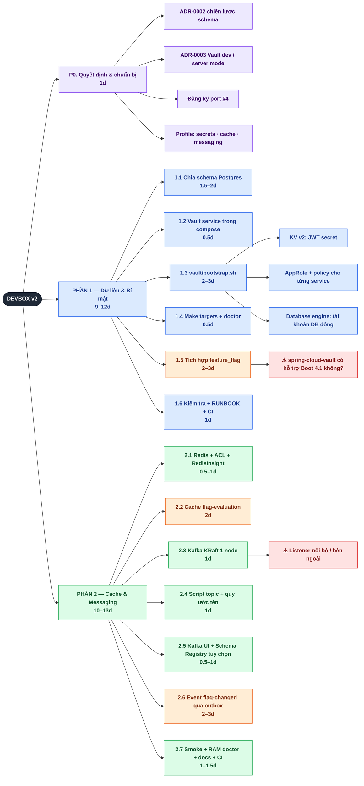
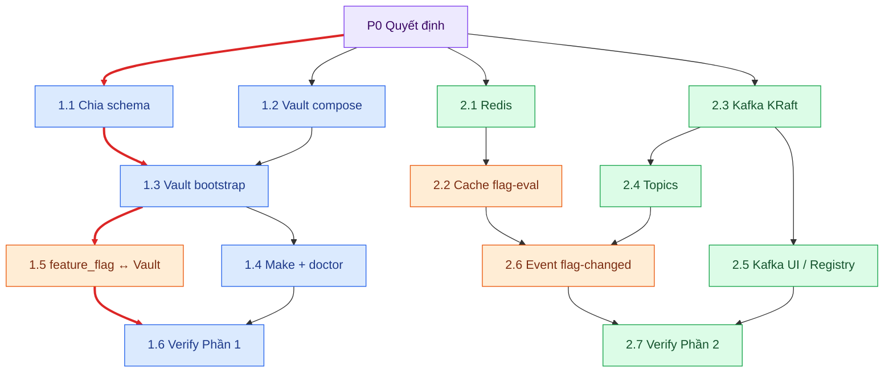
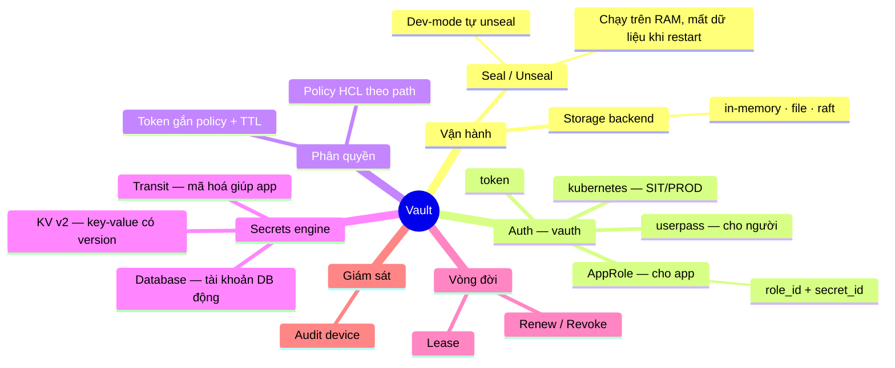
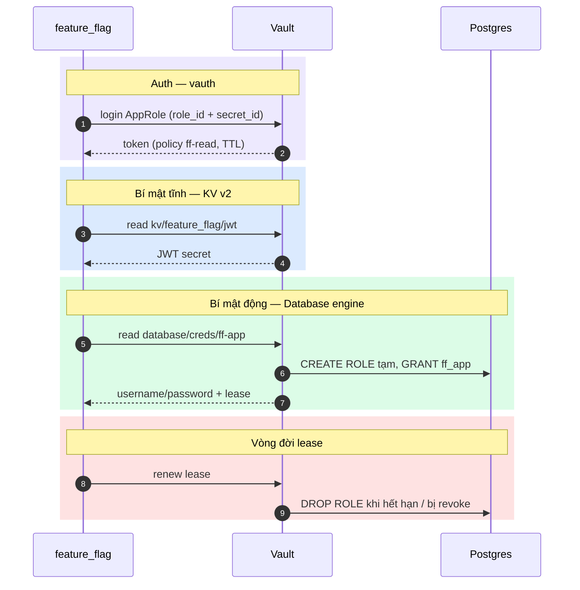
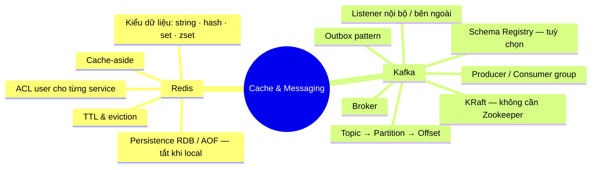
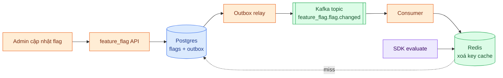
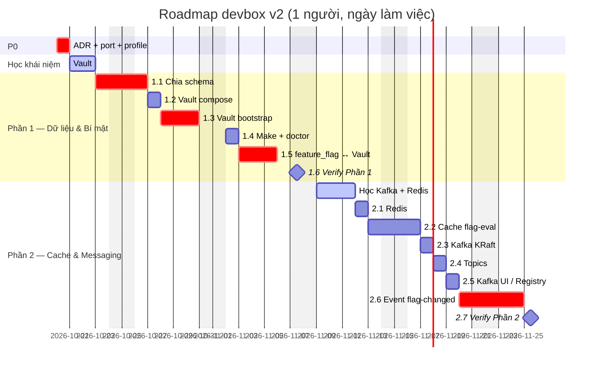

# onward-dev-box — Roadmap v2 (Vault · Schema · Redis · Kafka)

> Ngày lập: 2026-10-19 · Trạng thái: **Draft** — cần chốt các mục ở §1 trước khi tạo issue.
> Nền tảng hiện tại: Phase 1–3 trong `INFRASTRUCTURE.md` đã xong (còn #18).

**Hai phần việc** (chia theo phụ thuộc kỹ thuật):

| Phần | Nội dung | Lý do đi chung |
|---|---|---|
| **Phần 1 — Dữ liệu & Bí mật** | Chia schema Postgres + Vault | Vault cấp tài khoản DB động theo từng role của schema |
| **Phần 2 — Cache & Messaging** | Redis + Kafka | Luồng điển hình: flag đổi → Kafka event → xoá cache Redis |

**Chú thích màu** dùng trong toàn bộ tài liệu:

| Màu | Ý nghĩa |
|---|---|
| 🟪 Tím | P0 — quyết định / chuẩn bị |
| 🟦 Xanh dương | Phần 1 — Dữ liệu & Bí mật |
| 🟩 Xanh lá | Phần 2 — Cache & Messaging |
| 🟧 Cam | Tích hợp chéo repo (`feature_flag`) |
| 🟥 Đỏ | Rủi ro / điểm hay sai |

---

## 1. Cần chốt trước khi bắt đầu

1. **Chưa có service nào cần các thành phần này.** `INFRASTRUCTURE.md` §1 ghi rõ feature_flag *không cần* Redis/Kafka. Phải chọn một use case cụ thể trước, nếu không sẽ thành dựng hạ tầng mà không ai dùng.
2. **"Chia schema" có 2 nghĩa:**
   - (a) Postgres: mỗi service một schema.
   - (b) Kafka Schema Registry.

   Roadmap này giả định là (a); (b) để thành mục tuỳ chọn (2.5).
3. **Xung đột port:** Schema Registry mặc định chạy port `8081`, trùng với feature_flag. Phải đăng ký port `8085`.

---

## 2. Bản đồ phân rã

---

## 3. Phụ thuộc & critical path

Mũi tên **đỏ đậm** là critical path.

---

## 4. Phân rã khái niệm Vault ("vauth" = Vault auth)

| Lớp | Khái niệm | Ý nghĩa ngắn gọn |
|---|---|---|
| Bản chất | **Vault** | Nơi giữ bí mật, xác thực ai được đọc bí mật nào, và có thể mã hoá dữ liệu thay cho app |
| Vận hành | **Seal / Unseal** | Vault khởi động ở trạng thái khoá và cần key mới mở được. Dev-mode tự mở và chạy trên RAM, nên bootstrap phải chạy lại được |
| | **Storage backend** | Nơi Vault lưu dữ liệu (đã mã hoá) |
| **Auth (vauth)** | **Auth method** | Cách client chứng minh mình là ai: `token`, `userpass`, `AppRole`, `kubernetes` |
| | **Token** | Kết quả sau khi login, có TTL và gắn với các policy |
| Phân quyền | **Policy** | ACL viết bằng HCL theo path, ví dụ `path "kv/data/feature_flag/*" { capabilities = ["read"] }` |
| Bí mật | **Secrets engine** | Plugin mount vào một path: **KV v2**, **Database**, **Transit** |
| Vòng đời | **Lease** | Mỗi bí mật động có TTL, có thể renew; hết hạn hoặc bị revoke thì bị thu hồi |
| Giám sát | **Audit device** | Ghi log mọi request |

### Luồng app lấy bí mật

**Liên hệ với chia schema:** mỗi schema có các role `owner` / `app` / `readonly`. Mỗi role trong database engine của Vault tương ứng với một role Postgres, nên **1.1 phải xong trước 1.3**.

---

## 5. Phân rã khái niệm Redis & Kafka

### Luồng ghép Redis + Kafka (mục 2.6)

---

## 6. Đăng ký port mới (bổ sung `INFRASTRUCTURE.md` §4)

| Port | Service | Profile | Ghi chú |
|---|---|---|---|
| 8200 | Vault | secrets | |
| 6379 | Redis | cache | |
| 5540 | RedisInsight | tools | |
| 9092 | Kafka (listener cho host) | messaging | Listener nội bộ dùng `kafka:29092` |
| 8085 | Schema Registry | messaging | 🟥 Mặc định là 8081, trùng feature_flag |
| 8088 | Kafka UI | messaging | |

---

## 7. Ước lượng thời gian

> Gantt dùng màu theo trạng thái của Mermaid: **crit** (đỏ) = critical path, **active** (xanh) = học khái niệm, còn lại là màu mặc định.

| Hạng mục | Chỉ phía devbox | Tính cả tích hợp feature_flag |
|---|---|---|
| 🟪 P0 | 1d | 1d |
| 🟦 Phần 1 | ~5–6d | 9–12d |
| 🟩 Phần 2 | ~4–5d | 10–13d |
| Học khái niệm mới (Vault ~2d, Kafka ~2d, Redis ~0.5d) | +4.5d | +4.5d |
| **Tổng (1 người)** | **~2.5–3 tuần** | **~5–6 tuần** |

**Lưu ý về độ tin cậy:** bảng calibration của Phase 1–2 chưa ghi giờ thực tế (cột `Actual` vẫn trống), nên các con số này chưa được đối chiếu với tốc độ thực tế của team. Nên cộng thêm 20–30% buffer. Phần thuần devbox có thể nhanh hơn (Phase 1 cũ gồm 8 issue xong trong khoảng 2 ngày). Phần tích hợp chéo repo và phần học khái niệm mới thì khó rút ngắn.
